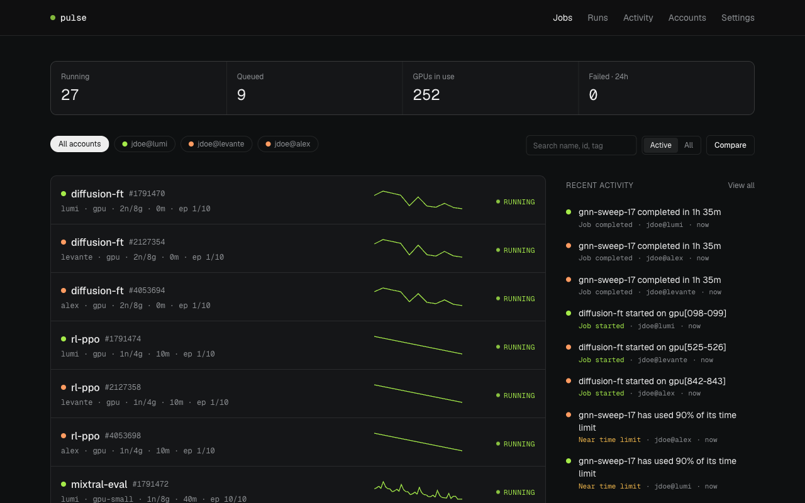
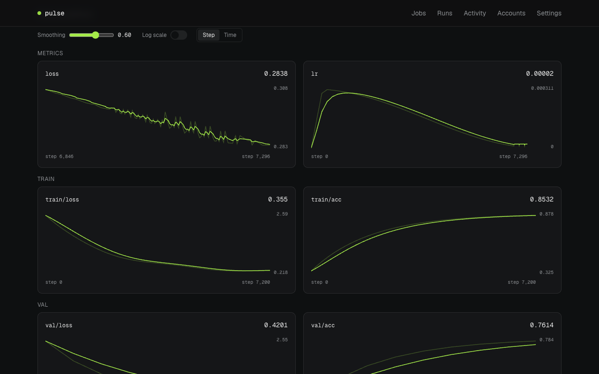
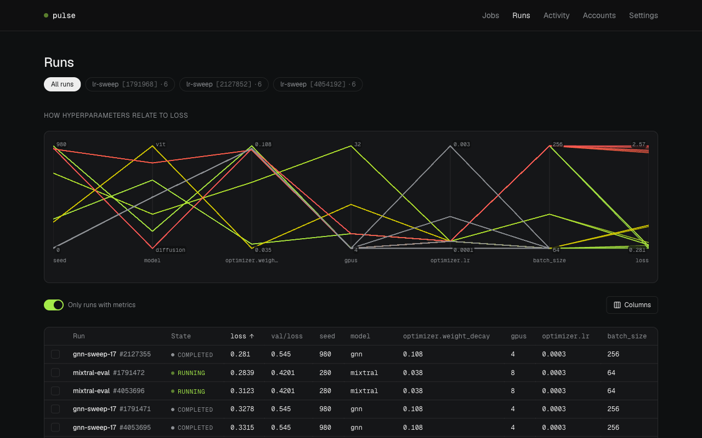
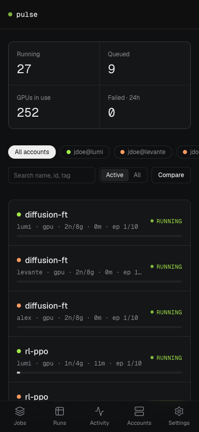
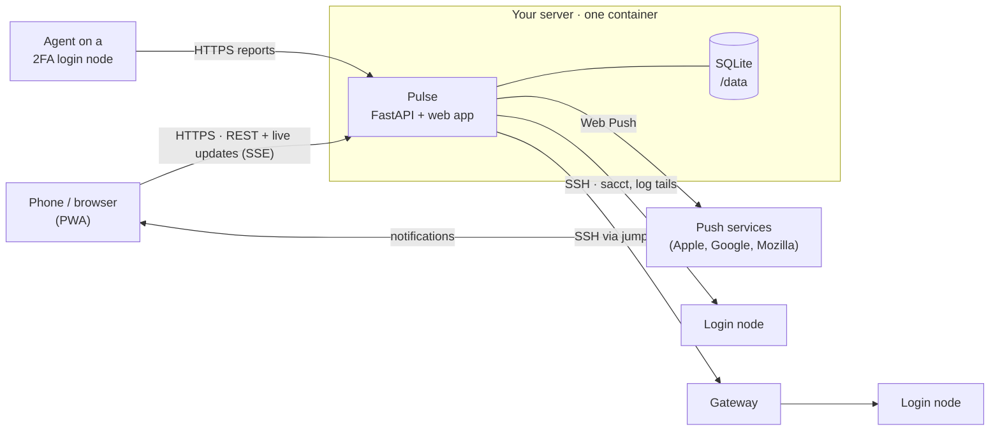

<div align="center">

# Pulse

**Every Slurm job on every cluster you use, live on your phone.**
Self-hosted monitoring for HPC jobs and training runs, with push alerts when something needs you.

<p>
<picture>
  <source media="(prefers-color-scheme: dark)" srcset="docs/assets/readme/jobs-dark.png">
  <source media="(prefers-color-scheme: light)" srcset="docs/assets/readme/jobs-light.png">
  
</picture>
</p>

<a href="https://hub.docker.com/r/neecat/pulse"></a>
<a href="https://hub.docker.com/r/neecat/pulse"></a>
<a href="https://hub.docker.com/r/neecat/pulse/tags"></a>

<a href="LICENSE"></a>

[Quick start](#quick-start) · [Deploy](#deploy-it-for-real) · [Connect a cluster](#connecting-clusters) · [Configuration](#configuration) · [Self-hosting guide](docs/deployment.md)

<a href="https://buymeacoffee.com/neecat"></a>

</div>

## Why Pulse

If you train models on HPC clusters, you know the loop: `ssh`, `squeue`, `tail -f`,
repeat, on every cluster where you have an allocation. You find out a job died hours after
it did, and the loss curve lives in a TensorBoard you can't open from your phone.

Pulse does that loop for you. It watches every job on every account you link, reads the
training metrics your jobs already write, and sends a push notification when a job starts,
finishes, fails, stalls, runs out of time, or its loss goes NaN. It installs on your
phone's home screen like an app.

It's built to be easy to run and kind to clusters:

- **One container, no extra services.** SQLite in one volume, about 70 MB of RAM. No
  database server, broker or cache to look after.
- **Nothing to change in your jobs.** Pulse reads TensorBoard event files, JSONL/CSV logs
  and `loss=…` lines your code already produces.
- **Read-only and gentle.** A few cheap Slurm commands per poll over one reused SSH
  connection. Pulse never submits, cancels or changes jobs.
- **Yours.** No accounts on someone else's server, no telemetry, no third-party requests
  from the web app (even the fonts are bundled). MIT licensed.

## Features

**Jobs, live**

- One list for every job on every linked account, colour-coded by cluster, with filters
  per account, search by name, id or tag, and an _Active / All_ switch.
- Changes appear as they happen: the server pushes updates over Server-Sent Events right
  after each poll. It polls every 10 s while you have Pulse open and every 60 s otherwise,
  and both are adjustable.
- A summary of running and queued jobs, GPUs in use and failures in the last 24 hours.
- A page per job: time used against the limit, epoch, latest loss, GPU utilisation and
  memory, the tail of its output log, plus your own tags and notes.

**Training metrics, without code changes**

<p>
<picture>
  <source media="(prefers-color-scheme: dark)" srcset="docs/assets/readme/job-dark.png">
  <source media="(prefers-color-scheme: light)" srcset="docs/assets/readme/job-light.png">
  
</picture>
</p>

- Reads what your jobs already write in their working directory:
  - **TensorBoard** event files (read directly, no TensorFlow needed);
  - `*metric*.jsonl` and `*metric*.csv` logs;
  - `step=… loss=…`-style lines in the job's output;
  - hyperparameters from `hparams.yaml` and `config.*` (W&B's `config.yaml` included).
- Files are read incrementally: each poll fetches only the bytes written since the last
  one, so a multi-gigabyte event file costs no more than a small one.
- Charts with TensorBoard-style smoothing, log scale and a step or wall-clock axis,
  grouped by prefix (`train/…`, `val/…`), plus loss sparklines in the job list.
- **Compare** runs: overlay their curves and diff their hyperparameters.

**Runs and sweeps**

<p>
<picture>
  <source media="(prefers-color-scheme: dark)" srcset="docs/assets/readme/runs-dark.png">
  <source media="(prefers-color-scheme: light)" srcset="docs/assets/readme/runs-light.png">
  
</picture>
</p>

- A runs table with a column for every metric and hyperparameter; sort it and choose
  which columns to show.
- Job arrays are grouped into sweeps automatically, with a parallel-coordinates chart of
  how each hyperparameter relates to the result.

**Alerts that matter**

| Alert                                | When                                                           |
| ------------------------------------ | -------------------------------------------------------------- |
| Started, finished, failed, cancelled | The job's Slurm state changes                                  |
| Near time limit                      | It has used 90% of its time limit (adjustable)                 |
| Stalled                              | Its output log hasn't changed for 15 minutes (adjustable)      |
| Loss is NaN                          | The loss becomes NaN or infinite                               |
| Diverging                            | The smoothed loss climbs 50% above its best value (adjustable) |
| Plateau                              | The loss hasn't improved for 60 minutes (adjustable)           |

- Delivered as Web Push to Android, desktop browsers and iPhones (iOS 16.4+, once Pulse is
  added to the home screen). There's no app store and no Firebase account to set up.
- Turn each kind on or off, mute accounts you don't need alerts from, and see the history
  in **Activity**.

**Clusters**

- **Direct SSH** with a key Pulse generates for itself; the app shows you the line to add
  to `authorized_keys`. It pins each server's host key on first connect.
- **Jump hosts** (`ssh -J`, `ProxyJump`): paste the same command you'd type, and Pulse
  tunnels through the gateway.
- **An agent for 2FA clusters**: where nothing can sign in unattended, a single-file
  Python 3.6+ script (standard library only) reports from the login node instead.
- **Per-node usage**: CPU, memory and every GPU on every node of a running job, sampled at
  most once a minute.

**Sign-in and security**

- Password sign-in with an admin account set from environment variables, or created in
  the browser with a one-time setup code.
- **Passkeys**: Face ID, Touch ID, Windows Hello or a security key, including autofill.
- Optional sign-up, so a group can share one instance; each person sees only their own
  accounts.
- scrypt password hashes, hashed session tokens, login rate limiting, CSRF protection and
  strict security headers (CSP, HSTS).

**On your phone**



- Installs to the home screen on iOS and Android as a Progressive Web App, full screen
  with its own icon.
- A layout built for phones first, with a bottom tab bar, plus light and dark themes that
  follow your system, compact density, and relative or clock times.
- Opens instantly from cached data and refreshes in place; there are no full-page
  spinners.

<br clear="right">

## Quick start

Try it with a simulated cluster, no HPC access needed:

```sh
docker run --rm -p 8000:8000 -e PULSE_SLURM_BACKEND=mock neecat/pulse
```

Open <http://localhost:8000>, enter the **setup code** printed in the container's output,
and create your account. Then add any account under **Accounts** (for example
`you@cluster.example.org`): the simulated cluster fills it with jobs, training curves and
sweeps within a minute.

## Deploy it for real

You need a machine that can reach your clusters over SSH, with
[Docker](https://docs.docker.com/get-docker/) and Compose, and a domain name pointing at it.

```sh
git clone https://github.com/neecatt/hpc-monitoring-app.git pulse && cd pulse
cp .env.example .env        # set PULSE_DOMAIN and PULSE_ADMIN_PASSWORD
docker compose up -d        # Pulse plus Caddy, which gets the HTTPS certificate
```

Open `https://<your domain>`, sign in, and add your clusters.

> [!IMPORTANT]
> **HTTPS is required** for push notifications, passkeys and installing on a phone.
> Compose sets it up with Caddy. No domain? The [self-hosting guide](docs/deployment.md)
> covers a private setup with Tailscale, running behind your own proxy, and running without
> Docker. Behind a proxy, set `PULSE_TRUSTED_PROXIES` so Pulse sees the real scheme.

> [!WARNING]
> **Keep `/data` on a persistent volume.** It holds the database _and Pulse's SSH key_.
> Lose it and you'll have to add the new key on every cluster again.

**Turn on push notifications.** Generate a key pair once and add it to `.env`:

```sh
docker compose run --rm pulse pulse gen-vapid
```

Then restart (`docker compose up -d`), open **Settings → Notifications** and allow them.
On an iPhone, add Pulse to the home screen first (Share → _Add to Home Screen_) and enable
notifications from the installed app.

**Upgrade** with `docker compose pull && docker compose up -d`. The database schema updates
itself.

## Connecting clusters

Open **Accounts → Add account** and paste the login you already use, the way you'd type it
after `ssh`:

```text
jdoe@lumi.csc.fi
ssh -p 2222 jdoe@cluster.example.org
ssh -J gateway.example.org jdoe@cluster.example.org
```

Then choose how Pulse connects:

|               | How it works                                                                                                      | Use it when                                              |
| ------------- | ----------------------------------------------------------------------------------------------------------------- | -------------------------------------------------------- |
| **Direct**    | Pulse signs in over SSH with its own key (through a jump host if you gave one) and runs read-only Slurm commands. | You can `ssh` in with a key and no 2FA prompt            |
| **Via agent** | You paste one command on the login node. A small script then reports to Pulse over HTTPS.                         | The cluster requires 2FA or short-lived SSH certificates |

<details>
<summary><b>Direct: authorising Pulse's key</b></summary>

Pulse generates an Ed25519 key in `/data` on first start. **Settings → Connection** shows the
public key with a ready-to-paste command:

```sh
echo 'ssh-ed25519 AAAA… pulse' >> ~/.ssh/authorized_keys
```

Run it on the cluster, or upload the key wherever your centre manages SSH keys (some use a
web portal, which usually covers the jump host too). Then press **Connect**: Pulse tests the
login straight away and pins the host key. With a jump host, Pulse's key must be accepted on
the gateway as well as the login node.

Pulse uses its own key, never yours. To use an existing key instead, set
`PULSE_SSH_KEY_PATH`.

</details>

<details>
<summary><b>Via agent: clusters with 2FA</b></summary>

Pulse gives you one command to run on the login node. It installs `~/.pulse-agent.py` and a
cron entry that reports every minute. The agent only sends raw `sacct`/`scontrol` output, log
tails and metric-file chunks; the server does all the parsing.

- Check it with `python3 ~/.pulse-agent.py status`, and read errors in
  `~/.config/pulse-agent/agent.log`.
- If the cluster doesn't allow cron, the agent stops when your session ends. Use a direct
  connection instead, through a jump host if needed.
- Remove it with `python3 ~/.pulse-agent.py uninstall`.

</details>

**What Pulse runs on the cluster:**

- `sacct --json` for your jobs, every poll;
- `scontrol` and `stat`/`tail` on your jobs' output and metric files, reading only new bytes;
- at most once a minute per running job, a short `srun` step that samples CPU, memory and
  `nvidia-smi` on each node (Slurm 20.11 or newer).

It's always read-only, and all of it runs over one SSH connection that stays open.

## Configuration

Everything is set with `PULSE_*` environment variables, from `.env` or from Docker secrets
in `/run/secrets`. Every setting is optional.

| Variable                                                                                                  | What it does                                                                                                                                        | Default                    |
| --------------------------------------------------------------------------------------------------------- | --------------------------------------------------------------------------------------------------------------------------------------------------- | -------------------------- |
| `PULSE_ADMIN_USERNAME`, `PULSE_ADMIN_PASSWORD`                                                            | Admin account. The password follows the variable, so change it there and restart. Unset: create the admin in the browser with the logged setup code | _(unset)_                  |
| `PULSE_DOMAIN`                                                                                            | Public hostname Caddy gets a certificate for (compose only)                                                                                         | —                          |
| `PULSE_PUBLIC_URL`                                                                                        | Pins the address passkeys belong to                                                                                                                 | the request's host         |
| `PULSE_TRUSTED_PROXIES`                                                                                   | Proxies allowed to set `X-Forwarded-*`; `*` behind a platform proxy                                                                                 | `127.0.0.1`                |
| `PULSE_VAPID_PUBLIC_KEY`, `PULSE_VAPID_PRIVATE_KEY`                                                       | Push notification keys, from `pulse gen-vapid`                                                                                                      | _(push off)_               |
| `PULSE_VAPID_SUBJECT`                                                                                     | Contact sent with push messages                                                                                                                     | `mailto:admin@example.com` |
| `PULSE_ALLOW_SIGNUP`                                                                                      | Let anyone with the URL create an account                                                                                                           | `false`                    |
| `PULSE_SESSION_DAYS`                                                                                      | How long a sign-in lasts                                                                                                                            | `30`                       |
| `PULSE_SLURM_BACKEND`                                                                                     | `ssh` for real clusters, `mock` for a simulated one                                                                                                 | `ssh` in the image         |
| `PULSE_SSH_KEY_PATH`                                                                                      | Use an existing private key instead of the generated one                                                                                            | `/data/pulse_ed25519`      |
| `PULSE_SSH_KNOWN_HOSTS`                                                                                   | Strict host-key checking against a `known_hosts` file                                                                                               | pin on first use           |
| `PULSE_POLL_INTERVAL_LIVE_SECONDS`                                                                        | Poll interval while someone has Pulse open                                                                                                          | `10`                       |
| `PULSE_POLL_INTERVAL_IDLE_SECONDS`                                                                        | Poll interval otherwise                                                                                                                             | `60`                       |
| `PULSE_NODE_STATS_INTERVAL_SECONDS`                                                                       | Per-node usage sampling (each sample starts a job step)                                                                                             | `60`                       |
| `PULSE_STALL_MINUTES`, `PULSE_TIME_LIMIT_WARNING_RATIO`, `PULSE_DIVERGE_PERCENT`, `PULSE_PLATEAU_MINUTES` | Default alert thresholds; users can change their own in the app                                                                                     | `15`, `0.9`, `50`, `60`    |
| `PULSE_PORT` (or `PORT`)                                                                                  | Port Pulse listens on                                                                                                                               | `8000`                     |

The full list, with SSH timeouts and cookie settings, is in
[`backend/.env.example`](backend/.env.example).

**Command line:** `pulse serve`, `pulse gen-vapid`, `pulse create-user <name>` and
`pulse reset-password <name>`, which also signs that user out everywhere. In Docker, use
`docker compose exec pulse pulse …`.

## How it works



- **`backend/`**: Python 3.12, FastAPI and async SQLAlchemy on SQLite. A poller visits each
  account, turns state changes into events, sends Web Push, and streams one live update per
  cycle to every open app. `pulse/slurm/` is the only code that knows about Slurm.
- **`frontend/`**: React 19, Vite, TanStack Router and Query, and Tailwind. The charts are
  plain SVG with no chart library. It's built into the image and served by the same process,
  so the whole app sits on one origin.
- **`backend/src/pulse/agent/`**: the single-file agent for clusters Pulse can't reach directly.

### Your data

Everything lives in `/data` (a Docker volume):

| File                                 | Contents                                                                               |
| ------------------------------------ | -------------------------------------------------------------------------------------- |
| `pulse.db`                           | Users, linked accounts, jobs, metrics, events, push subscriptions, passkey public keys |
| `pulse_ed25519`, `pulse_ed25519.pub` | Pulse's SSH key. Keep it private, and back it up                                       |

Back up `/data` and you've backed up everything. Passkey private keys never leave your
devices. Pulse stores only hashes of passwords and session tokens.

## Development

Needs Python 3.12+ and [bun](https://bun.sh).

```sh
make install     # dependencies for both packages
make dev         # API on :8000 and the web app with hot reload on :5173, on a simulated cluster
make check       # lint, type checks and tests, as CI runs them
make demo        # build and run the Docker image locally
```

`backend/` and `frontend/` are independent packages that talk only over the HTTP API.
[AGENTS.md](AGENTS.md) describes the architecture and conventions, and
[CONTRIBUTING.md](CONTRIBUTING.md) explains how to propose a change and how releases work.

## Images

[`neecat/pulse`](https://hub.docker.com/r/neecat/pulse) on Docker Hub, mirrored to
`ghcr.io/neecatt/pulse`, for amd64 and arm64:

| Tag                      | Contents                                         |
| ------------------------ | ------------------------------------------------ |
| `latest`, `0.1`, `0.1.0` | Releases. Pin a version for predictable upgrades |
| `edge`                   | The newest code on `main`                        |

## How Pulse is built

Pulse is developed with [Claude Code](https://claude.com/claude-code), Anthropic's coding
agent. Much of the code, tests and documentation were drafted in Claude Code sessions, and
[`AGENTS.md`](AGENTS.md) holds the project context those sessions start from.

- **A person decides and ships.** What goes in, what gets merged and every release are the
  maintainer's call.
- **Tests hold the logic in place.** Slurm parsing, metric readers, alert rules, SSH (against
  real in-process SSH servers, jump hosts included) and the API are covered by tests that
  run on every pull request.
- **Pulse itself doesn't use AI.** Nothing in it calls an AI service.

## Support

Pulse is free and stays free: MIT licensed, no paid tier, nothing held back. If it saves you
a few `ssh … squeue` round trips and you'd like to say thanks, you can buy me a coffee. A
star, a bug report or a pull request helps just as much.

<a href="https://buymeacoffee.com/neecat" target="_blank">
  
</a>

## Contributing and security

Bug reports and pull requests are welcome; start with [CONTRIBUTING.md](CONTRIBUTING.md).
Please report security issues privately, as described in [SECURITY.md](SECURITY.md).

## License

[MIT](LICENSE). Use it, change it and share it; keep the copyright notice.
