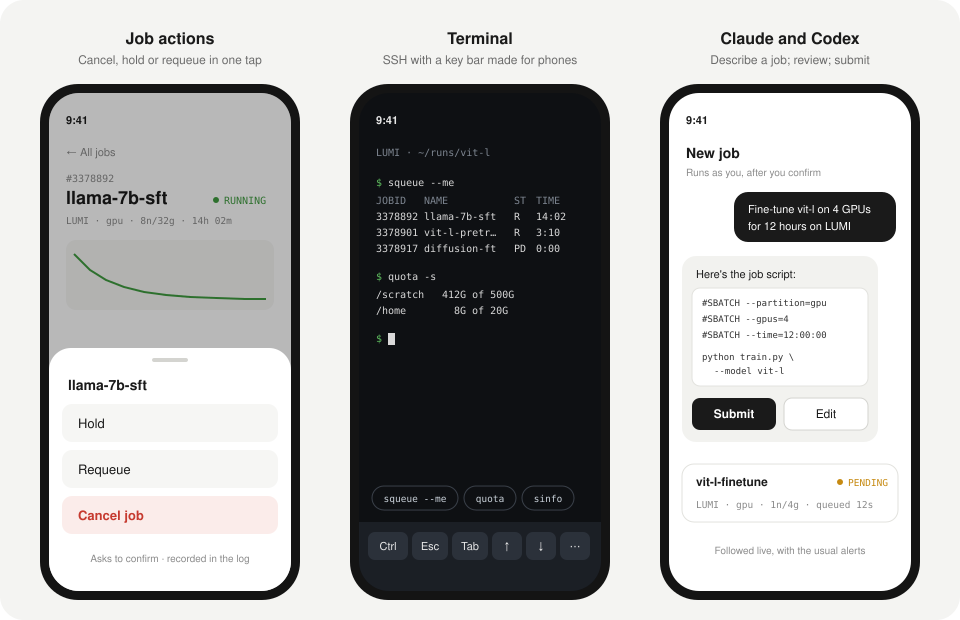
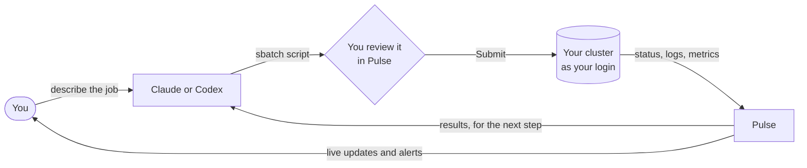

# Roadmap

What's planned for Pulse. Nothing has a date yet: ideas and votes are welcome in
the issues, and [CONTRIBUTING.md](CONTRIBUTING.md) explains how to help build
them.

**Already shipped:** teams (invite links, sharing whole accounts or single jobs,
live read-only views, opt-in alerts) and the public site (one-click demo,
passkey sign-up), plus cluster assistants: embedded Codex chat and official Claude Remote Control
(optional, direct SSH, native sign-in and local conversation resume).

  

Sketches of planned screens, not final designs.

## At a glance

| Feature                                               | What you get                                                | On the cluster |
| ----------------------------------------------------- | ----------------------------------------------------------- | -------------- |
| **Control from your phone**                           |                                                             |                |
| [Job actions](#job-actions)                           | Cancel, hold, release or requeue a job in one tap           | Acts ✋        |
| [Terminal](#terminal)                                 | An SSH terminal in the app, made for phones                 | Acts ✋        |
| [Submit jobs](#submit-jobs)                           | Resubmit a job, or submit from saved templates              | Acts ✋        |
| [Claude and Codex](#claude-and-codex)                 | Describe a job in words; an AI assistant writes and runs it | Acts ✋        |
| **Know more about your jobs**                         |                                                             |                |
| [Queue estimates](#queue-estimates)                   | Queue position, expected start, and why a job is waiting    | Reads          |
| [Cluster and quota status](#cluster-and-quota-status) | Free GPUs, fair-share, GPU-hour budget and storage quotas   | Reads          |
| [Full log viewer](#full-log-viewer)                   | Whole output and error files: searchable, live              | Reads          |
| **Share and connect**                                 |                                                             |                |
| [More alert channels](#more-alert-channels)           | Alerts by email, Slack, Discord, Telegram or ntfy           | —              |
| [Metrics export](#metrics-export)                     | A Prometheus endpoint for Grafana and existing monitoring   | —              |

✋ asks you first. "Reads" features only look, like Pulse does today.

## Safety first

Pulse only **reads** from clusters today: it never submits, cancels or changes
anything. The four features marked ✋ change that, so they all follow the same
rules:

1. **Off until the admin turns them on**, per server. A default install stays
   read-only.
2. **Only as you.** Actions run as your cluster login with your own Pulse key:
   they can do exactly what you could do over SSH, and nothing more.
3. **Asked and recorded.** Every action asks you to confirm and is logged (who,
   what, when) where you and the admins can see it.
4. **Direct connections only.** The login-node agent stays one-way: it reports,
   and never runs commands sent by the server.

## Control from your phone

### Job actions

Cancel, hold, release or requeue a job from its page (`scancel`, `scontrol`),
for a whole array or a single task. The most common reason to open a terminal,
done in one tap and a confirmation.

### Terminal

An SSH terminal to a linked cluster, inside the app, for everything Pulse has no
button for: checking a file, editing a config, running a quick command.

Details

- **Made for phones:** a key bar for Ctrl, Esc, Tab and the arrows, copy and
  paste, and saved snippets (`squeue --me`, `quota`, …) one tap away.
- **Opens in place:** from a job, it starts in the job's working directory.
- **Safe by design:** opening it asks for your passkey or password again;
  sessions close when idle; start and end are logged.
- **No outside code:** the terminal emulator is bundled with the app, like the
  fonts.

### Submit jobs

Resubmit a finished or failed job with the same script, or start one from a
saved `sbatch` template with a few fields to fill in (time, GPUs, arguments).
New jobs show up in the list at once, with the usual alerts.

### Claude and Codex

**First version is implemented:** the Assistants tab connects to Codex with
ChatGPT device sign-in and embedded chat/approvals, or to Claude Code with native
sign-in and official Remote Control. Both can resume local cluster conversations.
Claude prompts and approvals open in its own mobile/web UI. See
[the assistant guide](docs/assistants.md). Richer script previews, a separate
Pulse command-policy layer and explicit chat-to-job linking remain planned.

Ask an AI assistant to run a job: "fine-tune vit-l on 4 GPUs for 12 hours",
"resubmit the failed sweep tasks with half the learning rate". It writes the
`sbatch` script, you check it and press Submit, and the job is followed in
Pulse like any other.

- **Your assistant, your account:** you connect your own Claude or Codex
  access. Pulse sends nothing to an AI provider unless you set one up.
- **Nothing runs without you:** the script and every command are shown first,
  and only your confirmation sends them to the cluster.

## Know more about your jobs

### Queue estimates

For waiting jobs: their place in the queue, Slurm's expected start time
(`squeue --start`) and the reason they're waiting, in plain words. An optional
alert fires just before a job starts.

### Cluster and quota status

A page per cluster with free nodes and GPUs per partition (`sinfo`), your
fair-share and GPU hours used from your budget (`sshare`, `sreport`), and your
storage quotas, with a warning before one fills up and jobs start failing.

### Full log viewer

A job's whole output and error files, with search, a jump to the first error,
and a live tail. Files load in chunks, so large logs stay fast on a phone.

## Share and connect

### More alert channels

Alerts by email, Slack, Discord, Telegram or [ntfy](https://ntfy.sh) besides
push notifications, chosen per alert type. Handy on desktops without push and
for team channels.

### Metrics export

A Prometheus `/metrics` endpoint with job counts, states, queue times and
per-node GPU usage, for Grafana or existing monitoring. It has its own token,
separate from signing in.
